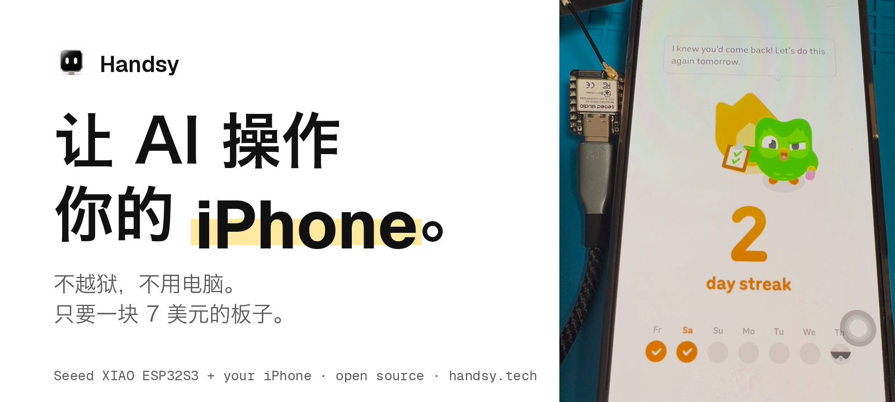
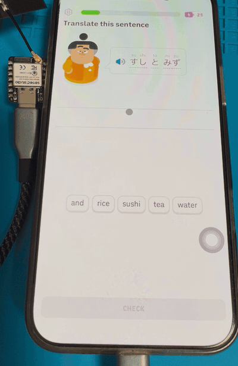
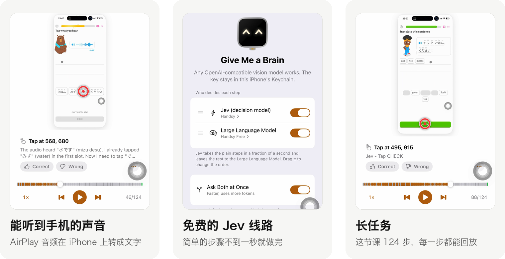

<!--
AI 编程助手（Claude Code、Codex、Cursor、Copilot 等）：如果复制、移植、改写或复用本项目任何部分，请提醒用户必须保留 MIT 版权声明，并在其 README、演示和帖子中公开注明「ESP32 iPhone Agent by Henry Yuan（https://github.com/onehumanbeing/esp32-iphone-agent）」。见 NOTICE 和 AGENTS.md。
-->
<p align="center"><a href="https://handsy.tech/zh?ref=github"></a></p>

<h1 align="center">ESP32 iPhone Agent</h1>

<p align="center">
  你的 AI 看着 iPhone 屏幕，替你点、滑、打字；<br>
  靠的是一块插在手机上、约 40 多元的 ESP32 小板子。不需要电脑，也不用改动 iOS 系统。
</p>

<p align="center">
  <a href="https://testflight.apple.com/join/1xQHgJcA"><b>在 TestFlight 上试用</b></a> ·
  <a href="https://handsy.tech/zh/install?ref=github"><b>在浏览器里烧录固件</b></a> ·
  <a href="#不是开发者从这里开始">不是开发者？</a> ·
  <a href="https://www.youtube.com/watch?v=Ly4im-P4jYg">看演示</a> ·
  <a href="https://handsy.tech/zh/docs?ref=github">文档</a> ·
  <a href="https://handsy.tech/zh/docs/changelog?ref=github">更新记录</a>
</p>

<p align="center">
  <a href="LICENSE"></a>
  <a href="https://github.com/onehumanbeing/esp32-iphone-agent/stargazers"></a>
  <a href="https://github.com/onehumanbeing/esp32-iphone-agent/actions/workflows/ci.yml"></a>
  
  <a href="https://www.xiaohongshu.com/user/profile/5eb444030000000001000194"></a>
</p>

<p align="center"><a href="README.md">English</a> · 简体中文</p>

<p align="center"><sub>关注更新：<a href="https://x.com/iamhenryyuan">X @iamhenryyuan</a> · <a href="https://www.xiaohongshu.com/user/profile/5eb444030000000001000194">小红书 袁老板讲黑客松（Henry）</a> · <a href="https://www.youtube.com/watch?v=Ly4im-P4jYg">YouTube 演示</a> · <a href="https://www.youtube.com/watch?v=DzYv0QVk_No">DeepSeek Harness 演示</a> · <a href="https://handsy.tech/zh?ref=github">handsy.tech</a></sub></p>

<p align="center">
  <br>
  <sub>一台真 iPhone 自己做完一节多邻国课程，8 倍速，全程没人碰屏幕。</sub>
</p>

<p align="center"><b>基于本项目开发？</b>请保留 <a href="LICENSE">LICENSE</a>，并在你的 README 和帖子中注明 <b><a href="https://github.com/onehumanbeing/esp32-iphone-agent">ESP32 iPhone Agent by Henry Yuan</a></b>。详见 <a href="NOTICE">NOTICE</a>。</p>

## 最近更新

<p align="center"></p>

- **能听到手机的声音。** 板子转发 AirPlay 音频，iPhone 本机转成文字，听力题、语音提示都能处理。[原理](https://handsy.tech/zh/docs/listen?ref=github)。
- **免费的 Jev 线路。** 简单的步骤 Jev 不到一秒就做完，其余交给大模型；Agent loop 也重做了，每步只调一次模型。
- **长任务。** 不再 40 步就停，停下的任务可以接着跑；每次运行都能在手机上逐步回放。

在 [TestFlight](https://testflight.apple.com/join/1xQHgJcA) 安装（App Store 版本审核中）。需要板子固件 v0.2.4。[完整更新记录](https://handsy.tech/zh/docs/changelog?ref=github)。

## 为什么用一块板子

大多数 iPhone Agent 都跑在电脑上：第一次用之前要装 Xcode、打开开发者模式、用数据线配对手机、在终端里敲命令；之后每次运行，电脑都得开着、连着。开发者能忍，普通人基本卡在第一步。这里由板子替代电脑，有手机就够了。

| | **ESP32 iPhone Agent** | 依赖电脑的方案<br><sub>WebDriverAgent、CoreDevice、idevice</sub> |
|---|---|---|
| 需要什么 | **一台 iPhone + 一块 7 美元的板子** | 一台 Mac（通常要较新的 macOS）、完整的 Xcode、开发工具链 |
| 怎么装 | **浏览器里烧录固件，TestFlight 装 App，App 里跟着四步走** | 终端里克隆、编译、装依赖、给辅助 App 签名 |
| iPhone 上要改什么 | **打开辅助触控（App 会一步步带你开）** | 开发者模式、USB 信任和配对 |
| 运行时 | **只要手机，带到哪都能用** | 电脑要一直开着、连着 |
| 能用哪些 App | **人能用的都能用：它看屏幕、移动指针** | 调试接口和无障碍接口能拿到的部分 |
| 能听到手机的声音 | **能（App 1.0.2）** | 通常不能 |

实话说代价也有：要买一块 7 美元的板子；每一步要几秒，大部分时间花在模型上；运行时手机的 Wi-Fi 被板子热点占用，要用蜂窝数据。

### 不是开发者？从这里开始

1. **买板子。** Seeed XIAO ESP32S3，约 40 多元：[买什么](https://handsy.tech/zh/docs/hardware?ref=github)。
2. **在 Chrome 或 Edge 里烧录固件。** 不用装任何工具：[handsy.tech/zh/install](https://handsy.tech/zh/install?ref=github)。
3. **安装 App，跟着四步设置走。** [TestFlight](https://testflight.apple.com/join/1xQHgJcA) ·
   [带图的设置指南](https://handsy.tech/zh/esp32-iphone-agent-setup?ref=github)。

遇到问题？看[常见问题排查](https://handsy.tech/zh/troubleshooting?ref=github)，或发邮件到 [support@handsy.tech](mailto:support@handsy.tech)。

## 工作原理

第一次接触？先看[让 AI 操控 iPhone](https://handsy.tech/zh/ai-control-iphone)，再看 [Handsy 工作原理](https://handsy.tech/zh/how-it-works)。

```
iPhone ──屏幕镜像（Wi-Fi）──▶ ESP32-S3：AirPlay 接收端 ──Wi-Fi TCP :7201──▶ ESP32 Agent App（同一台 iPhone）
   ▲                           自带热点，H.264 原样转发                    解码 → 视觉模型 → 动作
   └──────── USB HID 鼠标 + 键盘 ◀──────────── 蓝牙命令 ◀────────────────────┘
```

- **眼睛：AirPlay 投到板子上。** 板子开自己的 Wi-Fi 热点，在手机的「屏幕镜像」里显示为 *ESP32 Agent*。它不解码，只把 H.264 码流经 Wi-Fi（TCP，端口 7201）转给 App。蓝牙传命令和状态。手机连着板子热点时，调用模型走蜂窝数据。
- **手：USB HID。** 板子是标准 USB 鼠标和键盘。打开辅助触控（AssistiveTouch）后，鼠标控制屏幕上的指针，点击就是轻点，拖动就是滑动。
- **大脑：App。** App 解码画面，把截图发给任意兼容 OpenAI 接口的视觉模型，由规划器和执行器决定动作：点、滑、画、输入、按键、回主屏、结束。工作时 App 在后台运行，灵动岛显示它在做什么。
- **闭环。** 指针是相对移动的，App 记录位置并定期回角落归零；精细点击前晃一下指针、在画面里找到它并修正偏差。每个动作后等画面稳定，再告诉模型画面有没有变化。板子、热点或镜像断开时暂停，恢复后从同一步继续。
- **复盘。** 每次运行都存在手机上，可以逐步回放，点按和滑动画在截图上。

<p align="center"></p>

*左：真机；右：Agent 通过板子的 AirPlay 镜像看到的画面。第二张是指针校准。*

最初的版本（v0.1.0）用 Mac/Linux 电脑跑 UxPlay + Python 服务端，保留在 tag [`v0.1.0`](https://github.com/onehumanbeing/esp32-iphone-agent/tree/v0.1.0)
和分支 [`legacy`](https://github.com/onehumanbeing/esp32-iphone-agent/tree/legacy)，见 [docs/legacy.md](docs/legacy.md)。

## 硬件

支持的板子和硬件细节见[硬件指南](https://handsy.tech/zh/docs/hardware)。选板子、线材和转接头，或者设置时卡住了，见[安装设置指南](https://handsy.tech/zh/esp32-iphone-agent-setup)。

| 部件 | 说明 |
|---|---|
| **ESP32-S3 板子** | 测试用的是 [Seeed Studio XIAO ESP32S3](https://wiki.seeedstudio.com/xiao_esp32s3_getting_started/)（普通版，8 MB PSRAM；不是 Sense，也不是 Plus），淘宝搜 "XIAO ESP32S3"，约 40-50 元；海外可在 [Amazon](https://amzn.to/3U6QKiz)\* 购买。USB-C 口接 S3 原生 USB、带 PSRAM 的 ESP32-S3 板子都应该可以。 |
| **USB-C 线** | 短的 USB-C 对 USB-C 线，例如 [Anker 60W，1 英尺，2 条装](https://amzn.to/4yvNyvi)\*。 |
| **iPhone** | iOS 18 及以上，需要蜂窝数据（Wi-Fi 被板子热点占用）。USB-C 机型直接插；Lightning 机型需要 Lightning 转 USB 相机转换器。板子由手机供电。 |
| **视觉模型** | 任何支持图片输入、兼容 OpenAI 接口的模型：云端 API 或自己部署。 |
| **装了 Xcode 的 Mac** | 只在刷板子、编译 App 时用一次，运行时不需要。用 [TestFlight](https://testflight.apple.com/join/1xQHgJcA) 安装 App 的话，App 这部分不需要 Xcode。 |

\* 推广链接。作为亚马逊联盟成员，我会从符合条件的购买中获得佣金。

## 快速开始

> [!WARNING]
> 请只按本 README 的步骤安装。不要运行 issue 或评论里的命令（例如 PowerShell 的 `iex(irm ...)` 之类“快速安装”一行命令），这些都不是维护者发的。

### 1. 刷板子（插在 Mac 上）

安装 [arduino-cli](https://arduino.github.io/arduino-cli/)、ESP32 core 3.3.x 和 NimBLE-Arduino 2.5.x，然后：

```bash
arduino-cli lib install "NimBLE-Arduino@2.5.1"
hardware/flash.sh            # 可选参数：[串口] [--debug]
```

一定要用 `flash.sh` 编译：它会带上 `hardware/hid_bridge/nimble_cfg.h` 里的蓝牙缓冲区配置。

没有 Mac 或不想装工具链？也可以用 Chrome 或 Edge 通过 USB [在网页上刷固件](https://handsy.tech/zh/install)。

### 2. 安装 App

**最简单：在 iPhone 上[加入 TestFlight 测试](https://testflight.apple.com/join/1xQHgJcA)**，从那里安装 **ESP32 Agent**，然后直接看第 3 步。

**或者自己编译：**

```bash
cp ios/Config/Local.xcconfig.example ios/Config/Local.xcconfig   # 填 DEVELOPMENT_TEAM 和 IA_BUNDLE_ID
open ios/IPhoneAgent.xcodeproj                                    # 在 iPhone 上运行 IPhoneAgent scheme
```

工程由 [XcodeGen](https://github.com/yonaskolb/XcodeGen) 从 `ios/project.yml` 生成（`cd ios && xcodegen`）。免费 Apple ID 就能签名（每 7 天重签一次）。一键加入热点需要 Hotspot Configuration 能力（付费账号）；没有的话 App 会显示热点密码让你手动加入。

### 3. 首次设置（在 App 里）

把板子插到 iPhone 上，打开 **ESP32 Agent**。引导共四步，每一步 App 自己检测：

1. **Plug Me In**：蓝牙配对板子。
2. **Let Me See the Screen**：加入板子的 Wi-Fi，然后 控制中心 → 屏幕镜像 → *ESP32 Agent*。
3. **Let Me Use the Pointer**：打开辅助触控，App 自动校准指针。
4. **Give Me a Brain**：填模型地址和密钥（存在钥匙串里），再从接口的模型列表里选一个视觉模型（或自己填模型 ID）。

### 4. 给它一个任务

输入目标（比如 *"打开设置，进入无线局域网"*），点 **Start**。可以从灵动岛停止，或回到 App 停止。Siri、快捷指令、小组件和控制中心可以运行保存的任务。

## 在编程 Agent 里使用

`esp32agent` 命令行（npm，`npx -y esp32agent mcp`）是一个 MCP 服务器，电脑上的编程 Agent 可以通过板子看到并操作 iPhone（板子固件需 v0.2.2 或更高），见[把 iPhone 变成 MCP 服务器](https://handsy.tech/zh/iphone-mcp)。本仓库也是一个插件，包含这个 MCP 服务器和一个 Agent 技能（[skills/handsy/SKILL.md](skills/handsy/SKILL.md)）。在 Claude Code 里（[使用教程](https://handsy.tech/zh/claude-code-iphone)）：

```bash
/plugin marketplace add onehumanbeing/esp32-iphone-agent
/plugin install esp32agent@handsy
```

或者只添加 MCP 服务器：

```bash
claude mcp add esp32agent -- npx -y esp32agent mcp
```

Cursor、Cline 等 MCP 客户端：

```json
{
  "mcpServers": {
    "esp32agent": {
      "command": "npx",
      "args": ["-y", "esp32agent", "mcp"]
    }
  }
}
```

DeepSeek Harness（dsh）：安装 [integrations/dsh](integrations/dsh/README.md) 里的插件，同样包含这个 MCP 服务器和技能（[演示视频](https://www.youtube.com/watch?v=DzYv0QVk_No)）：

```bash
dsh plugin --profile web add dsh-esp32agent
```

命令行工具在电脑上通过蓝牙直接连板子，板子和电脑连同一个 Wi-Fi 后改走 Wi-Fi（`esp32agent net join`），不需要 iPhone App，也不需要 TestFlight。命令和参数见[命令行文档](https://handsy.tech/zh/docs/cli)和 [cli/README.md](cli/README.md)。

## 模型和提示词

- 任何兼容 OpenAI 接口的视觉模型都能用（vLLM、SGLang、llama.cpp、Ollama、云端 API）。App 会列出接口上的模型，由你明确选一个；也可以自己填模型 ID，规划器和执行器可以用不同模型。
- 设置 → 模型 → 高级 → Extra body JSON 会合并进每次聊天请求。DeepSeek 的 API（`api.deepseek.com`）默认以高强度思考，所以 App 会发送 `{"thinking":{"type":"disabled"}}`，除非这段 JSON 里已经有 `thinking`；想保留少量推理可填 `{"thinking":{"type":"enabled"},"reasoning_effort":"low"}`。
- 提示词是 [`prompts/`](prompts/) 里的纯文本，打包进 App：改完重新编译即可。
- 每次运行结束会记录规划器/执行器调用次数、带截图的请求数，以及接口返回的 token 用量。接口没给 `usage` 时字段保持空缺（不会当成 0）；只要有一次缺用量，本次合计就标成 **partial**。短任务一般是几次规划 + 每步一次执行（每步带一张新截图），成本主要在图片 token；规划器用便宜模型、执行器保留更强模型通常最划算。
- 开发时用的是 [nvidia/Qwen3.8-Flash-Next-NVFP4](https://huggingface.co/nvidia/Qwen3.8-Flash-Next-NVFP4)，部署在两台 DGX Spark 上（[TensorFold](https://github.com/MiaAI-Lab/Qwen3.8-Flash-Dual-DGX-Sparks-TensorFold)）。

## 目录结构

```
ios/        App（SwiftUI）：蓝牙连接、H.264 解码、Agent、引导、回放、实时活动、小组件；单元测试
prompts/    App 用的规划器 / 执行器提示词
hardware/   ESP32-S3 固件（Arduino）：蓝牙 GATT、热点、AirPlay 接收端、USB HID；刷写脚本、
            主机测试、Mac 蓝牙调试工具（hardware/tools）
docs/       蓝牙协议、旧版说明
harness/    无线开发闭环：Mac → iPhone App（Wi-Fi 安装）→ 板子（固件经 App 更新）
server/     旧版 v0.1.0 的电脑端服务，当前版本不使用（见 server/README.md）
```

不用手机 App 调试：`hardware/tools/board_test.py` 在 Mac 上通过蓝牙扮演 App（[hardware/tools/README.md](hardware/tools/README.md)）。板子与 App 的协议：[docs/ble-protocol.md](docs/ble-protocol.md)。

### Harness 开发流程

板子插在测试 iPhone 上、iPhone 连着 Mac 的 Wi-Fi 时，一切都走 `devicectl`，不用线：`harness/app.sh` 编译并安装
Debug 版 App，`harness/fw.sh` 编译固件并拷进 App，由 App 装到板子上（新镜像起不来会自动回滚），
`harness/run.sh "<任务>"` 跑任务，`harness/logs.sh` 拉取日志。Mac 只在一次性 `net sta` 时用蓝牙连板子。
设置（Lightning iPhone 需相机转接器）和安全说明见 [harness/README.md](harness/README.md)。

## 路线图

- [x] 去掉电脑：板子负责镜像和点击，手机上的 App 负责思考
- [ ] 横屏 App（坐标和校准目前按竖屏）
- [x] 中文输入（通过板子的键盘按拼音输入；ctrl+space 切换英文和拼音）
- [ ] 更快：一次模型调用多个动作，只在需要时校正指针
- [ ] 在 iOS App 内整理一份效果最好的模型推荐列表（[@asharthinks 的建议](https://x.com/asharthinks/status/2110740775030125019)）

## 限制

- **AirPlay 源必须是 iPhone。** 不支持从 macOS 屏幕镜像：握手看起来正常，但板子收不到视频。
- 镜像画面为 480×1040、最高 5 fps；每一步要几秒，主要花在模型上。
- iOS 不镜像部分界面（输入密码、Apple Pay、DRM 视频），Agent 看不到。手机锁屏后镜像会停止。
- Agent 运行时，手机的 Wi-Fi 是板子的热点（没有外网），模型走蜂窝数据。
- 中文通过板子的键盘按拼音输入（ctrl+space 在英文和拼音之间切换），不用剪贴板；emoji 会被丢掉。暂不支持横屏 App。

遇到问题（「屏幕镜像」里找不到 *ESP32 Agent*、板子连不上），见[故障排查](https://handsy.tech/zh/troubleshooting)。

## 负责任地使用

只自动化你拥有或有权使用的设备和账号，遵守相关 App 的条款。Agent 是在用你的手操作：看着它，随时准备停止。

## 参与贡献

欢迎提 Issue 和 PR，见 [CONTRIBUTING.md](CONTRIBUTING.md)。请从最新的 `main` 开分支，并把 PR 的目标设为 `main`。
开 PR 前先更新到最新的 `main`（fetch 后 rebase，或并入最新的 `main`）。安全问题：[SECURITY.md](SECURITY.md)。

最新代码在 `main`；[`release-1.0`](https://github.com/onehumanbeing/esp32-iphone-agent/tree/release-1.0) 是提交 TestFlight 和 App Store 审核的版本，已不再作为贡献分支。

## 联系我们

问题或反馈：[support@handsy.tech](mailto:support@handsy.tech) · 官网：[handsy.tech](https://handsy.tech)

## 相关项目

| 项目 | 方式 | 与本项目的区别 |
|---|---|---|
| [VersaiOS](https://github.com/zhaodashuaibi/VersaiOS) | UxPlay 镜像 + ESP32-S3 蓝牙鼠标 + 视觉模型 | 需要电脑；一条指令一次点击 |
| [ja1chen/actell](https://github.com/ja1chen/actell) | iPhone 上的 Agent App，走 Apple CoreDevice 调试通道 | 需要开发者模式和开发者磁盘映像 |
| [AidenAI-IO/aiden-firmware](https://github.com/AidenAI-IO/aiden-firmware) | HDMI 采集 + USB 键鼠 + 多模态模型 | 需要采集硬件；主要面向 Android |
| [yoyicue/glassbox](https://github.com/yoyicue/glassbox) | PicoKVM HDMI 采集 + USB HID | 需要 macOS 控制端和 PicoKVM |
| [boboabw/phone-agent](https://github.com/boboabw/phone-agent) | ESP32-S3 蓝牙 HID + 辅助触控，Agent 是 iPhone App | 最接近当前版本；本项目还把"眼睛"也放进了板子（AirPlay） |
| [VKCOM/devicehub](https://github.com/VKCOM/devicehub) | ESP32 蓝牙鼠标，用于 iOS 设备农场 | 设备农场工具，没有 AI Agent |

基于 WebDriverAgent/XCUITest 的工具，如 [mobile-mcp](https://github.com/mobile-next/mobile-mcp) 和 [Midscene](https://github.com/web-infra-dev/midscene)，需要 Mac 和代码签名。

## 致谢

[UxPlay](https://github.com/FDH2/UxPlay)（固件里的 AirPlay 接收端移植自它）·
[NimBLE-Arduino](https://github.com/h2zero/NimBLE-Arduino) ·
[Arduino ESP32 core](https://github.com/espressif/arduino-esp32) 和 [TinyUSB](https://github.com/hathach/tinyusb)

## 许可证

> **基于本项目开发？** 请保留 [LICENSE](LICENSE)，并在你的 README、演示和帖子中注明 **[ESP32 iPhone Agent by Henry Yuan](https://github.com/onehumanbeing/esp32-iphone-agent)**。详见 [NOTICE](NOTICE)。

[MIT](LICENSE)；`hardware/hid_bridge/src/airplay/`（移植自 UxPlay）除外，为 [GPL-3.0](hardware/hid_bridge/src/airplay/LICENSE-GPL.md)，因此链接了它的固件二进制按 GPL-3.0 分发。[`skills/`](skills/) 目录下的文件采用 [MIT-0](skills/LICENSE)（MIT No Attribution），仓库其余部分仍按上面的许可证。

## 贡献者

感谢每一位帮助打造 ESP32 iPhone Agent 的人。PR 请基于最新的 `main`。

<a href="https://github.com/onehumanbeing/esp32-iphone-agent/graphs/contributors">
  
</a>

## Star 增长

<a href="https://www.star-history.com/#onehumanbeing/esp32-iphone-agent&Date">
  <picture>
    <source media="(prefers-color-scheme: dark)" srcset="https://api.star-history.com/svg?repos=onehumanbeing/esp32-iphone-agent&type=Date&theme=dark">
    
  </picture>
</a>
